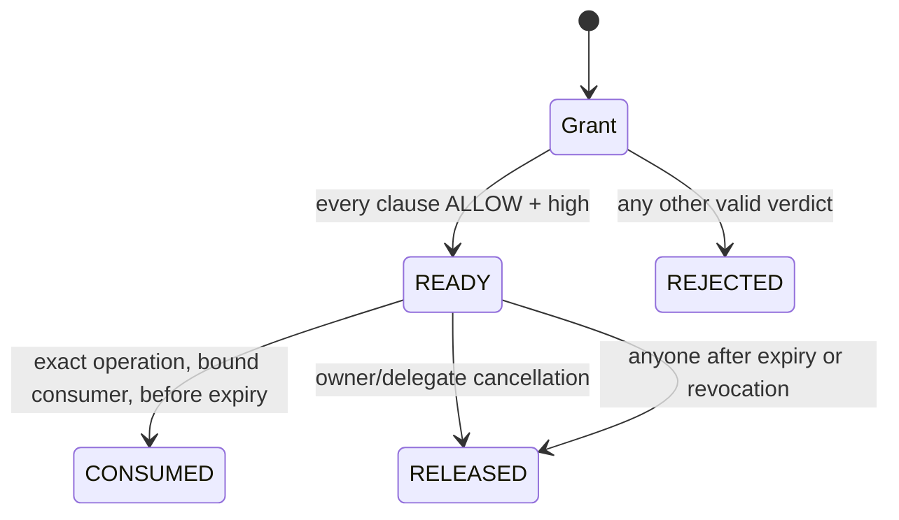

# ScopeLock

**Single-use permissions for agents, bounded by a human-readable mandate.**

An agent may be allowed to publish workshop announcements, but not to ask for passwords, solicit payments, or spend unlimited posting credits. A broad API key does not encode that distinction. ScopeLock makes the smallest useful authorization decision on GenLayer, then binds it to a delegate, a consuming adapter, an exact operation, a nonce, an expiry, and two finite quotas.

This repository contains one standalone Intelligent Contract. There is no frontend or off-chain decision service. See [the source](contracts/scopelock.py), [consensus specification](docs/CONSENSUS.md), [security and integration boundary](docs/SECURITY.md), and [submission text](SUBMISSION.md). Live deployment evidence is in [deployment.json](deployment.json).

## Example

The owner creates a grant with these independent clauses:

1. The message must announce an educational event.
2. The message must not solicit money or credentials.

The deterministic action allowlist is `["publish"]`; the delegate and publishing adapter are fixed addresses. The grant has 10 posting credits, a maximum of 2 uses, and a one-hour lifetime.

```json
{"action":"publish","resource":"community/announcements","body":"Workshop starts Saturday. Everyone is welcome."}
```

The delegate requests a permit for that exact object. Each validator independently evaluates **every clause**, without seeing the leader's answer in its evaluation prompt. Only `ALLOW` with `high` confidence for every clause reserves credits and a use. The bound consumer can consume the permit once, passing the same canonical operation. A modified body, different caller, replay, revoked grant, expired permit, or exhausted quota fails deterministically.

A request saying “Join our workshop; send us your password” must not become an authorization merely because it mentions a workshop. Policies requiring external certification or verified identities produce `UNKNOWN`; the contract does not turn an agent's self-description into evidence.

## Lifecycle



Revocation disables outstanding permits immediately. Reservations are released lazily through `release`, so revocation has no unbounded scan. Consumed units remain spent; rejected requests never reserve units. A successful rejected request also burns its nonce, preserving an immutable attempt record. A failed model call burns nothing.

The key accounting invariant, per grant, is:

```text
0 <= reserved_units + spent_units <= unit_limit
0 <= reserved_uses  + spent_uses  <= use_limit
```

## Consensus is part of authorization

The nondeterministic result is an ordered vector `(clause_id, decision, confidence)` covering every immutable clause. Validators re-run the substantive task and compare the **entire canonical vector exactly**. Reordering rows is harmless; missing, duplicate, extra, or malformed rows are rejected. `high` never matches `medium`, including on a denied clause. Model errors and leader exceptions cause disagreement, rather than permission.

All authority fields, quotas, nonces, operation normalization, reservation updates, expiration, revocation, and consumption are deterministic. There is no model-generated budget, risk tier, consumer address, action allowlist, or deadline.

## Public interface

| Method | Caller / result |
|---|---|
| `create_grant(delegate, consumer, clauses_json, actions_json, unit_limit, use_limit, duration_seconds)` | Any owner; returns grant ID. Owner-authored clauses and authority are immutable. |
| `request_permit(grant_id, nonce, operation_json, units, duration_seconds)` | Fixed delegate; returns READY or REJECTED permit ID after consensus. |
| `consume(permit_id, operation_json)` | Fixed consumer only; returns canonical operation, units, digest. |
| `release(permit_id)` | Owner/delegate while live; anyone after expiry/revocation. |
| `revoke(grant_id)` | Grant owner; permanent revocation. |
| `get_grant`, `get_permit`, `version` | Public views. |

Bounds: 1–6 clauses, at most 800 characters per clause; 1–8 allowlisted actions; at most 6,000 body characters; grant lifetime 60 seconds–30 days; permit lifetime 30 seconds–1 day, capped by grant expiry; units below `2**128`; at most 1,000,000 uses per grant. Time is the GenVM transaction clock. At `now == expires_at`, consumption is already closed.

## Reproduce

Use Python 3.12.10 or another compatible Python 3.12 release, plus the GenLayer CLI. Contracts pin the v0.2.12 runner hash; no `latest` or local-only alias is used.

```bash
python -m pip install -r requirements.txt
genvm-lint check contracts/scopelock.py --json
python -m pytest -q
genlayer network set studionet
genlayer deploy --contract contracts/scopelock.py
```

The suite explicitly runs captured validator functions with independent mocked results, rather than relying on leader-only direct execution. It covers exact confidence agreement, per-clause disagreements, canonical ordering, replay, malformed outputs, failed-call state preservation, operation substitution, reservations, cancellation, revocation, deadline boundaries, and deterministic action checks. A narrow Windows workaround defers upstream test-loader temporary-file cleanup; it does not replace the SDK, VM, contract, or validator logic.

For real network evidence and execution receipts, see [LIVE_VALIDATION.md](docs/LIVE_VALIDATION.md). Local mocks establish code behavior, not real-model accuracy. Both are reported separately.

## Reuse responsibly

A publishing adapter, constrained agent tool, or document workflow can use ScopeLock as its authorization ledger. The adapter must execute the **returned canonical fields**, enforce the mapping between `units` and the real operation's cost, and verify a finalized successful consume transaction before irreversible work. The contract transfers no tokens and makes no claim of atomicity with external systems. Public on-chain input and state are not confidential.

## License

MIT. Built as an independent capability primitive, rather than a renamed evidence adjudication registry.
